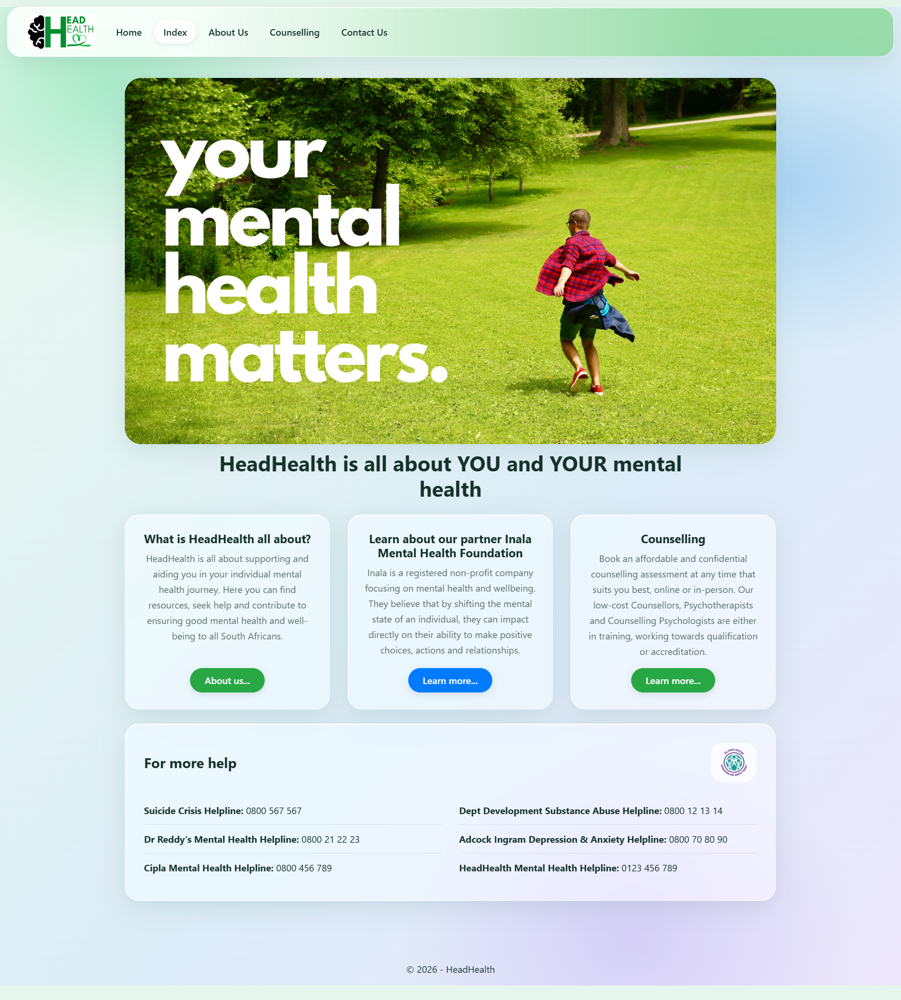
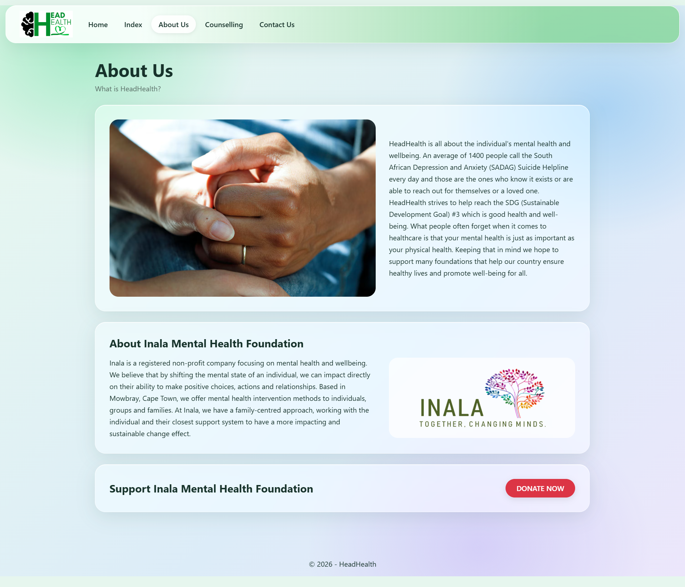
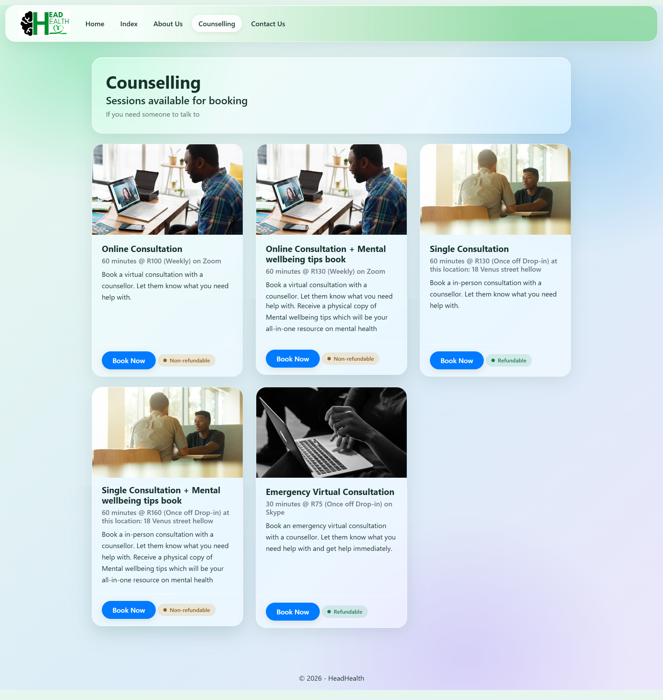
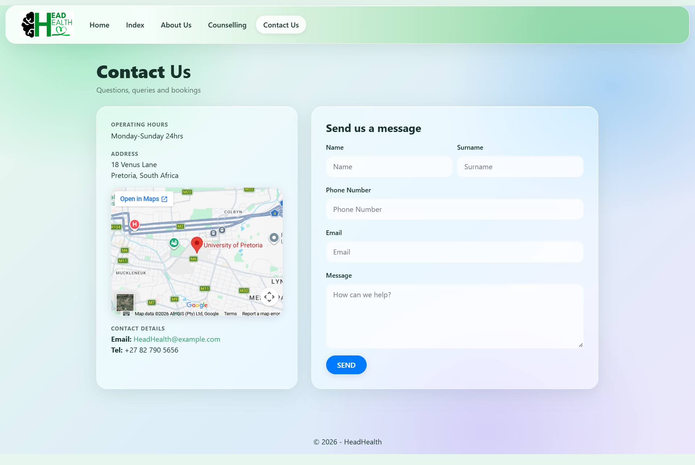

# HeadHealth: Mental Health & Counselling Website (ASP.NET MVC)

A multi-page website for **HeadHealth**, a fictional South African mental health and counselling service. Visitors can learn about the organisation and its partner, browse the counselling sessions on offer, find crisis helplines, and send the team a message.


- **Author:** Tifuh Nche
- **Course:** INF 272 - Advanced Programming
- **Institution:** The University of Pretoria
- **Assignment:** Homework 04 (HW04)
- **Year:** 2022

---

## Overview

This project was built for Homework 04 of the course above. The brief was to take a real-world scenario, model it with object-oriented design (use case narratives and a class diagram), and implement that design as an ASP.NET MVC web application.

The domain is based on the work of South African mental health organisations such as SADAG and the Inala Mental Health Foundation. HeadHealth supports the UN Sustainable Development Goal #3 (good health and well-being) by connecting people with counselling and helplines.

## Pages

| Page | Route | What it does |
|---|---|---|
| **Index** (landing page) | `/` or `/Home/Index` | Hero banner, an introduction to HeadHealth, its partner Inala Mental Health Foundation, a counselling summary, and a panel of South African mental health helplines |
| **About Us** | `/Home/About` | HeadHealth's mission, details about Inala, and a link to donate |
| **Counselling** | `/Home/Counselling` | Cards for every bookable session showing its name, duration, price, platform or location, description, and refund policy, each with a **Book Now** button |
| **Contact Us** | `/Home/Contact` | Operating hours, address, an embedded map, contact details, and a contact form |
| **Home** (documentation) | `/Home/Home` | The assignment write-up: use case narratives and the class diagram |

## Page Screenshots

### Index



### About Us



### Counselling



### Contact Us



## Object-Oriented Design

The counselling sessions are modelled as a class hierarchy in the `Models/` folder:

- **`Session`**: the base class, holding what every session shares (name, description, image, refund policy) and a `GetInfo()` method that summarises the session
- **`SingleConsult`**: an in-person, once-off consultation
- **`VirtualConsult`**: an online consultation held on a video platform
- **`EmergencyVirtualConsult`**: a shorter, urgent online consultation

The Counselling view receives a `List<Session>` and calls `GetInfo()` on each item, so every session type produces its own summary line without the view needing to know which type it is (polymorphism). The use case narratives and class diagram that this design is based on are in `Images/` and are displayed on the Home page.

## Features

- Session catalogue generated from the model list, so adding a session needs no view changes
- Refund policy shown on each session card
- Contact form whose submissions are appended to a text file in `App_Data/`
- Helpline directory for South African mental health services
- Responsive layout (desktop, tablet, phone) with a collapsing mobile menu
- Navigation bar that highlights the current page

## Design

The interface uses a **frosted-glass** style on top of Bootstrap 4: translucent blurred panels, rounded corners, soft shadows, and a mint-to-sky gradient background that echoes HeadHealth's green and blue branding.

All custom styling lives in a single file, `Content/glass.css`, which is loaded in `_Layout.cshtml` after the Bootstrap bundle. The navbar, footer, cards, buttons, and form fields are all styled there.

## Technologies Used

| Area | Technology |
|---|---|
| Framework | ASP.NET MVC 5.2.7 on .NET Framework 4.7.2 |
| Language | C# |
| View engine | Razor |
| Front end | Bootstrap 4.6.1, jQuery 3.4.1, Popper.js, Modernizr, custom CSS (`backdrop-filter`, CSS variables) |
| Bundling | System.Web.Optimization |
| IDE | Visual Studio 2019 |

## Project Structure

```
u21653268_HW04/
├── u21653268_HW04.sln
└── u21653268_HW04/
    ├── App_Start/               # BundleConfig, FilterConfig, RouteConfig
    ├── App_Data/                # Contact form submissions (contacts.txt)
    ├── Controllers/
    │   └── HomeController.cs
    ├── Models/
    │   ├── Session.cs
    │   ├── SingleConsult.cs
    │   ├── VirtualConsult.cs
    │   └── EmergencyVirtualConsult.cs
    ├── Views/
    │   ├── Home/                # Index, About, Counselling, Contact, Home
    │   └── Shared/              # _Layout, Error
    ├── Content/                 # Bootstrap, Site.css, glass.css
    ├── Scripts/                 # jQuery, Bootstrap, validation scripts
    ├── Images/                  # Logo, banner, session photos, diagrams
    ├── Global.asax
    ├── Web.config
    └── packages.config
```

## How to Run

**Requirements:** Windows, Visual Studio 2019 or later with the *ASP.NET and web development* workload, and the .NET Framework 4.7.2 developer pack.

1. Clone or download the repository.
2. Open `u21653268_HW04.sln` in Visual Studio.
3. Restore NuGet packages (right-click the solution, then **Restore NuGet Packages**).
4. Press **F5** to run with IIS Express. The site is configured for `https://localhost:44366/`.

## Notes

- Contact form messages are written to `App_Data/contacts.txt`, which holds personal details. It is listed in `.gitignore` and should not be committed.
- `bin/`, `obj/`, `packages/`, and `.vs/` are build output and are regenerated by Visual Studio.
- Helpline numbers, the address, and the email on the site are sample data for the assignment.
